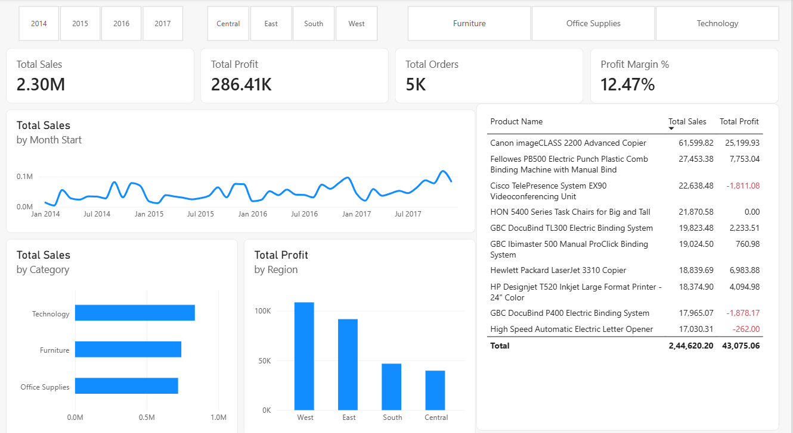

# Superstore Sales Analysis

End-to-end analysis of retail sales (2014 to 2017) using Python, SQL and Power BI. The project finds which products, regions and discount levels drive profit, and which ones lose money.

## Dashboard



## Business questions

- Which categories, regions and products make the most profit, and which lose money?
- How do discounts relate to profit?
- How have sales and profit changed from 2014 to 2017?

## Tools

Python (pandas, NumPy, Matplotlib, Seaborn), SQLite, Power BI Desktop, VS Code, Git/GitHub.

## Dataset

Superstore sales dataset from Kaggle: 9,994 rows and 21 columns, orders from 2014-01-03 to 2017-12-30. After cleaning, 9,993 rows and 5,009 unique orders remain.

## Key numbers

| KPI | Value |
|---|---|
| Total Sales | $2,296,919.49 |
| Total Profit | $286,409.08 |
| Total Orders | 5,009 |
| Profit Margin | 12.47% |

## Key insights

1. **Deep discounts erase profit.** Rows with a discount of 30% or more (13.9% of rows) lost $135,364 in total, while rows at 20% or less earned $421,773.
2. **Furniture sells a lot but earns little.** It is 32.3% of sales but only 6.4% of profit (2.49% margin).
3. **Tables and Bookcases lose money** and are among the most heavily discounted sub-categories (average discounts 0.261 and 0.211). Supplies also loses money, but its discount is low, so discounts do not explain it.
4. **Central region has the weakest margin** (7.92%) and the highest average discount (0.240), with 27.7% of rows at a discount of 30% or more, against 3.7% in West.
5. **Sales and profit grew** from 2014 to 2017 (51.5% and 88.6%), but the margin fell from 13.43% in 2016 to 12.74% in 2017.
6. **Top sellers are not always profitable.** Several top-10 products by sales lose money or break even.
7. **Technology and Office Supplies carry the profit**: 36.4% and 31.3% of sales, but 50.8% and 42.8% of profit.
8. **Consumer is the largest segment but has the lowest margin** (11.55%, against 14.05% for Home Office).

These results show relationships in this dataset, not proven causes.

## Validation

Total Sales, Total Profit, Total Orders and Profit Margin were calculated independently in Python, SQL and Power BI, and all three matched. The 2017 figures, the West region, the Technology category and the customer-segment results also matched across tools. Full tables are in `notebooks/03_sql_analysis.ipynb`.

## Data cleaning

- 0 missing values
- 1 exact duplicate row removed (9,994 to 9,993 rows)
- Order Date and Ship Date converted to dates, with no order shipped before it was ordered
- Postal Code stored as text
- 1,870 negative-profit rows kept on purpose, since they are real losses

## Project structure

```
superstore-sales-analysis/
├── data/
│   ├── raw/          original CSV
│   └── cleaned/      cleaned CSV
├── notebooks/
│   ├── 01_data_cleaning.ipynb
│   ├── 02_eda.ipynb
│   └── 03_sql_analysis.ipynb
├── sql/              SQL queries
├── powerbi/          Power BI dashboard (.pbix)
├── images/           dashboard and chart screenshots
├── requirements.txt
└── README.md
```

## How to run

1. Install the libraries: `pip install -r requirements.txt`
2. Run the notebooks in order: 01, 02, 03. Notebook 03 builds the SQLite database.
3. Open `powerbi/superstore_dashboard.pbix` in Power BI Desktop.

## Author

[Esam Khalid] | [https://www.linkedin.com/in/esam-khalid07/] | [(https://github.com/esamk15)]